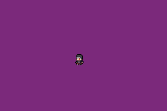

# orbits
Ninja Game© ~

Spawn in an arsenal of rapidly spinning shurikens that surround your character and move with your momentum.

You can spawn in these shurikens by pressing "x" on KBM, or you can press "a" on your personal gba.
You can decrease the amount of shurikens by pressing "z" on KBM or "b" on your personal gba.
Pressing start will restart the game (reset your shurikens)

https://moratsu.github.io/orbits/

